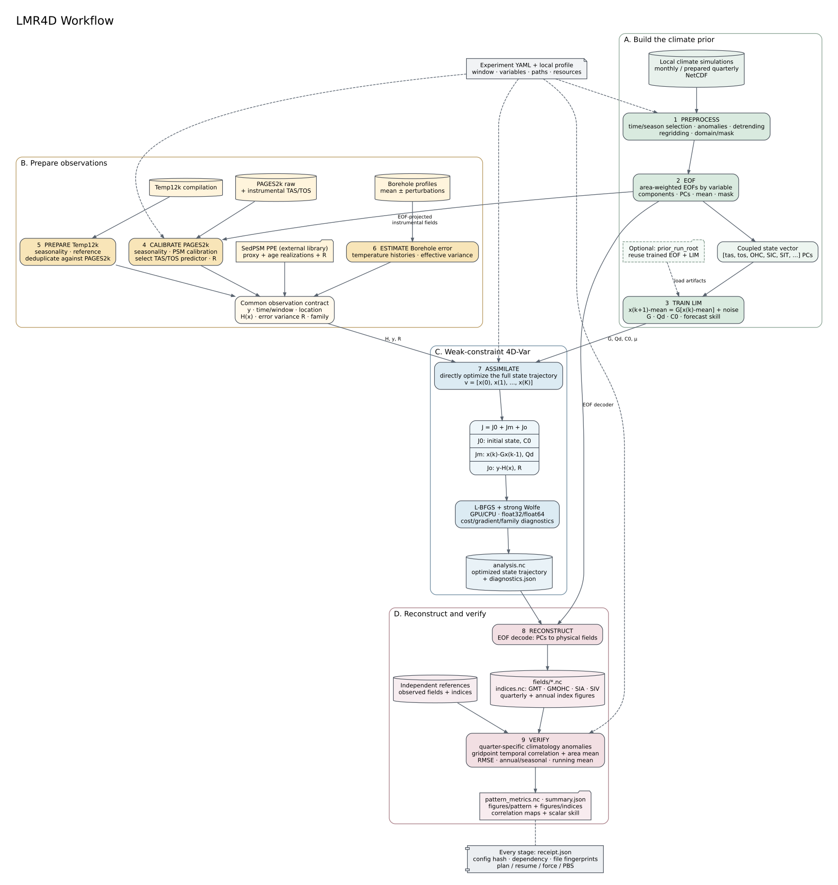

# LMR4D Workflow Diagram

The diagram follows the nine executable stages in `Stage.ordered()` while
separating the scientific data flows into four parts:

1. **Build the prior** from local simulations through preprocessing, EOF fitting,
   and coupled LIM training. A completed prior may instead be reused through
   `paths.prior_run_root`.
2. **Prepare observations** from PAGES2k, Temp12k, boreholes, and the external
   SedPSM PPE products. Every source is adapted to the common `H`, `y`, `R`,
   time, location, and family contract.
3. **Assimilate** by directly optimizing the complete state trajectory with the
   weak-constraint objective `J0 + Jm + Jo` and persistent L-BFGS history.
4. **Reconstruct and verify** physical fields and indices. Field skill uses
   gridpoint temporal correlations followed by cosine-latitude spatial
   averaging, matching the legacy verification definition.

Every completed stage writes a receipt containing the resolved configuration,
upstream dependency, and output fingerprints. These receipts support safe
planning, resumption, forced reruns, and PBS execution.

The editable Graphviz source is [`lmr4d_workflow.dot`](lmr4d_workflow.dot).

## 中文说明

- **A 气候先验：**本地模拟经过预处理和分变量 EOF，所有 PC 按统一
  `StateLayout` 拼接后训练耦合 LIM，得到 `G`、`Qd`、`C0` 和训练均值。
- **B 观测准备：**PAGES2k、Temp12k、borehole 和 SedPSM 最终都转换成统一的
  `H(x)`、观测值 `y`、误差方差 `R`、时间窗和位置描述。
- **C 同化：**弱约束 4D-Var 直接优化完整状态轨迹。目标函数由初始状态约束
  `J0`、LIM 模型误差 `Jm` 和 proxy 观测误差 `Jo` 组成，并用 L-BFGS 求解。
- **D 重建检验：**优化后的 PC 轨迹通过 EOF decoder 恢复物理场和气候指数；
  verification 输出逐格点时间相关、纬度加权平均相关、RMSE 和指数 skill。
